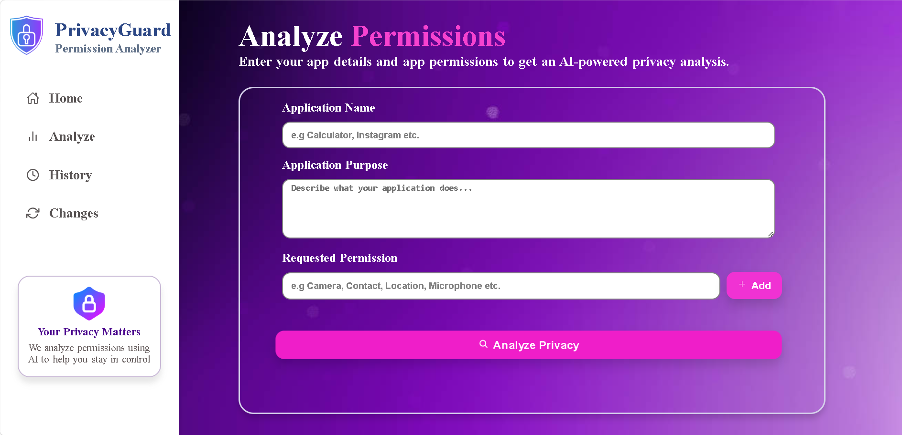
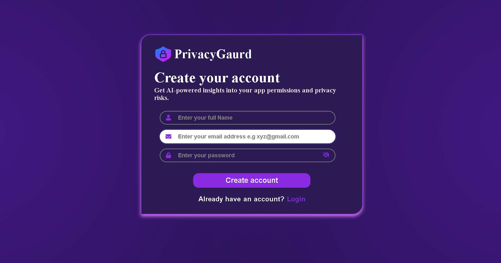
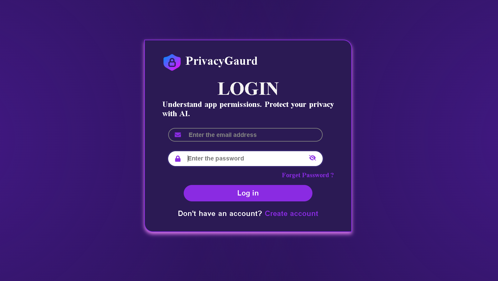
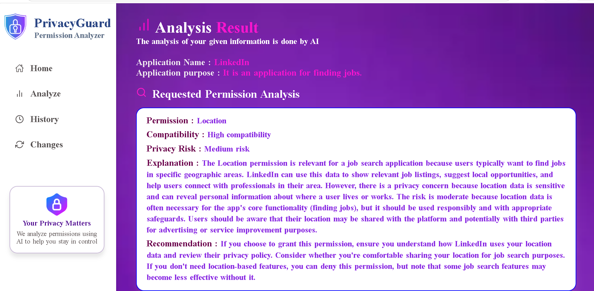
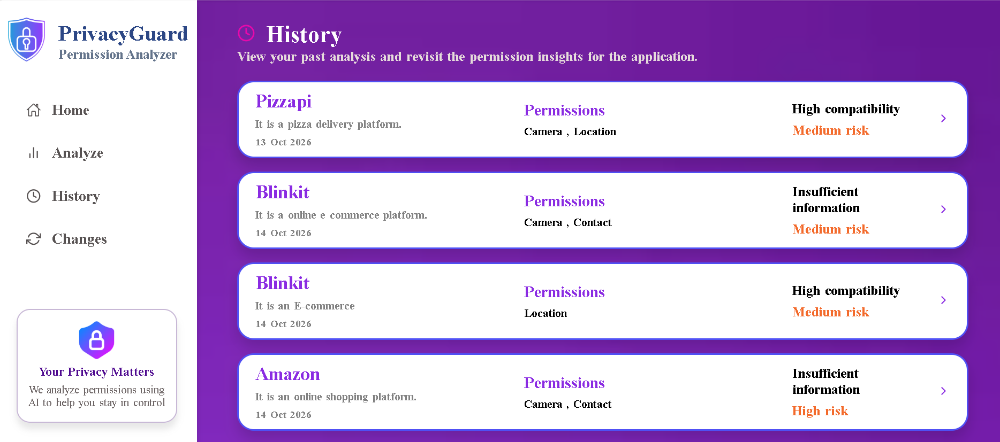

# 🛡️ PrivacyGuard – AI-Powered Permission Analyzer

**Understand App Permissions. Identify Privacy Risks. Protect Your Data.**

PrivacyGuard is an AI-powered application permission analyzer designed to help users understand the permissions requested by mobile applications and identify potential privacy risks.

It analyzes application permissions based on the app's name and intended purpose, helping users understand whether requested permissions are relevant, potentially unnecessary, or raise privacy concerns.

---

## 📸 Project Preview




---

## ✨ Key Features

- **User Authentication:** Secure user registration and login.
- **Permission Analysis:** Analyze permissions requested by applications.
- **AI-Powered Risk Assessment:** Generate insights into potential privacy risks.
- **Purpose Compatibility:** Evaluate whether requested permissions match the application's intended purpose.
- **Privacy Recommendations:** Get suggestions to improve application privacy.
- **Analysis History:** Access previously analyzed applications.
- **Application Updates:** Update existing application analysis records.
- **Detailed Analysis:** View detailed analysis results for individual applications.
- **AI Chat Assistance:** Get assistance understanding permission-related concerns.

---

## 🖥️ Application Screenshots

### 1. User Registration



### 2. User Login



### 3. Dashboard


### 4. Permission Analysis




### 5. Analysis History




---

## 🛠️ Technology Stack

| Technology | Purpose |
|---|---|
| React.js | Frontend development |
| JavaScript | Application logic |
| CSS | User interface styling |
| Node.js | Backend runtime |
| Express.js | REST API development |
| MongoDB | Database |
| Mongoose | Database modeling |
| Axios | HTTP requests |
| JWT | User authentication |
| bcrypt | Password hashing |
| AI API | Permission analysis and insights |

---

## 📂 Project Structure

```text
PrivacyGuard/
│
├── Frontend/
│   ├── public/
│   ├── src/
│   │   ├── components/
│   │   ├── pages/
│   │   ├── context/
│   │   ├── utils/
│   │   ├── App.jsx
│   │   └── main.jsx
│   ├── package.json
│   └── .env
│
├── Backend/
│   ├── config/
│   ├── models/
│   ├── routes/
│   ├── authmiddleware.js
│   ├── server.js
│   ├── package.json
│   └── .env
│
├── screenshots/
├── .gitignore
└── README.md
```

---

## ⚙️ Installation and Setup

Follow these steps to run PrivacyGuard locally.

### Prerequisites

Make sure you have installed:

- Node.js
- npm
- MongoDB or a MongoDB Atlas account
- Git

### 1. Clone the Repository

```bash
git clone YOUR_GITHUB_REPOSITORY_URL
cd PrivacyGuard
```

### 2. Set Up the Backend

Navigate to the backend directory:

```bash
cd Backend
```

Install the dependencies:

```bash
npm install
```

Create a `.env` file inside the Backend folder:

```env
PORT=3000
MONGO_URI=your_mongodb_connection_string
JWT_SECRET=your_jwt_secret
AI_API_KEY=your_ai_api_key
```

Start the backend server using the appropriate script from your `package.json`:

```bash
npm run dev
```

### 3. Set Up the Frontend

Open another terminal and navigate to the frontend directory:

```bash
cd Frontend
```

Install the dependencies:

```bash
npm install
```

Create a `.env` file inside the Frontend folder:

```env
VITE_API_URL=http://localhost:3000
```

Start the frontend development server:

```bash
npm run dev
```

### 4. Open the Application

Visit:

```text
http://localhost:5173
```

---

## 🔐 Environment Variables

The application uses environment variables to manage configuration and sensitive information.

| Variable | Description |
|---|---|
| `PORT` | Backend server port |
| `MONGO_URI` | MongoDB connection string |
| `JWT_SECRET` | Secret key for JWT authentication |
| `AI_API_KEY` | API key for the AI service |
| `VITE_API_URL` | Backend API URL used by the frontend |

**Important:** Never upload `.env` files, API keys, database credentials, or JWT secrets to GitHub.

---

## 🔄 Application Workflow

1. A user registers or logs in to PrivacyGuard.
2. The user enters an application's name and purpose.
3. The user provides the permissions requested by that application.
4. PrivacyGuard processes the submitted information.
5. AI generates privacy risk insights and recommendations.
6. The user can view the analysis results and access previous analyses.

---

## 🔒 Security

PrivacyGuard uses security practices including:

- Password hashing using bcrypt.
- JWT-based authentication.
- HTTP-only cookies for authentication token storage.
- Protected routes for authenticated users.
- Environment variables for sensitive configuration.
- Backend request validation.

---

## 🚀 Future Enhancements

- More detailed permission risk classification.
- Improved analysis accuracy.
- Application permission comparison.
- Downloadable privacy analysis reports.
- Enhanced privacy insights and recommendations.

---

## 🎯 Project Objective

The primary objective of PrivacyGuard is to make application permissions easier to understand and help users become more aware of potential privacy risks.

It aims to encourage informed decisions about application permissions and promote better digital privacy awareness.

---

## 👩‍💻 Developer

**Juhi Singh**

B.Tech – Computer Science and Engineering

**Project:** PrivacyGuard – AI-Powered Permission Analyzer

---

**PrivacyGuard – Your Permissions, Your Privacy, Your Control.**